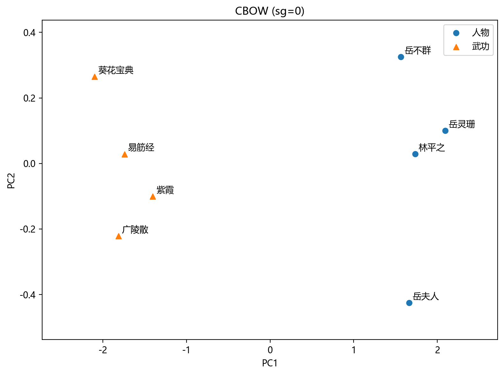
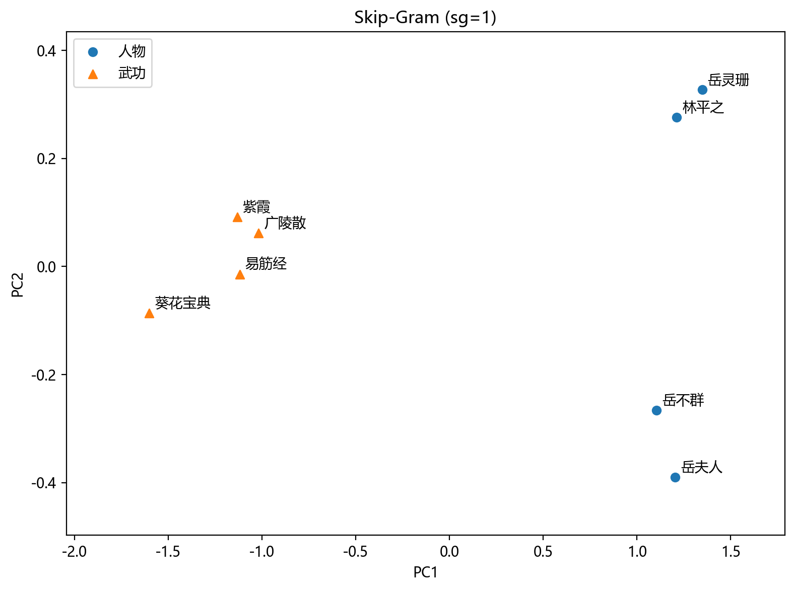
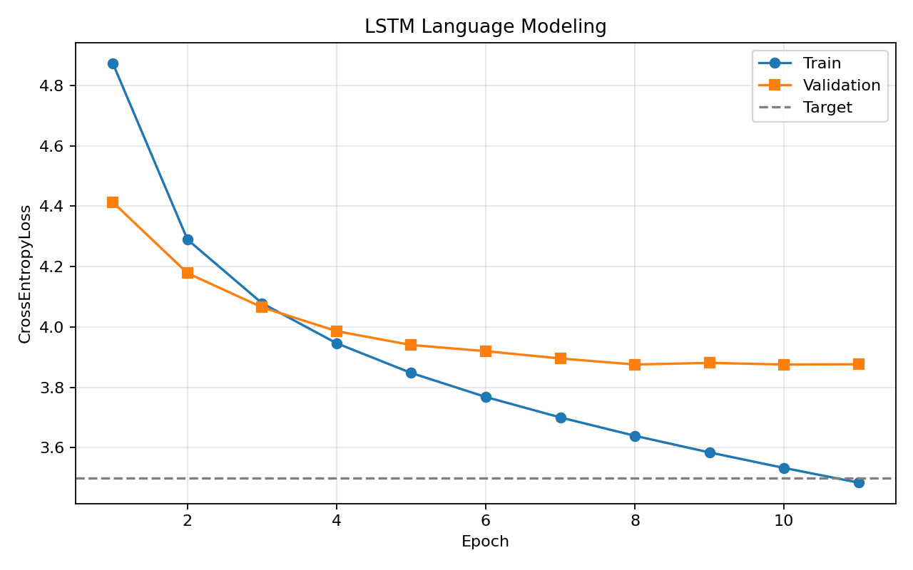

# 文本表示学习实验 | Text Representation Learning


基于 **Word2Vec、LSTM 和 DistilBERT** 的自然语言处理（NLP）实验项目，涵盖中文词向量学习、词级语言建模、英文情感分类与命名实体识别（NER）。项目提供从语料预处理、模型训练到指标评估和结果可视化的实验流程，便于学习不同文本表示方法及其在下游任务中的应用。

[快速开始](#快速开始) · [实验流程](#实验流程) · [实验结果](#实验结果) · [项目结构](#项目结构)

## 主要功能

| 实验 | 模型 / 方法 | 实验内容 |
| --- | --- | --- |
| 中文语料预处理 | chardet、jieba | 自动识别编码、中文分词、UTF-8 输出 |
| 词向量学习 | Word2Vec（CBOW / Skip-Gram） | 词语相似度、词向量类比、PCA 降维可视化 |
| 词级语言建模 | LSTM | 下一词预测、交叉熵损失、验证集困惑度 |
| 情感分类 | DistilBERT + CLS / Mean / Max Pooling | SST-2 二分类、池化方法对比 |
| 命名实体识别 | DistilBERT Token Classification | CoNLL-2003 序列标注、实体级 Precision / Recall / F1 |

## 项目结构

```text
konmogwolmegdge1/
├── data/
│   ├── text.txt               # 原始中文语料
│   ├── seg_text.txt           # 原始语料分词结果
│   ├── new_text.txt           # 扩展中文语料
│   ├── new_seg_text.txt       # 扩展语料分词结果
│   ├── word2id.json           # 仓库提供的词到 ID 映射
│   └── id2word.json           # 仓库提供的 ID 到词映射
├── result/                    # 已提交的实验指标、训练日志及图片
├── process.py                 # 编码识别与中文分词
├── word2vec.py                # CBOW / Skip-Gram 训练
├── play.py                    # 词向量分析与 PCA 可视化
├── lstm.py                    # LSTM 词级语言模型
├── BERT.py                    # 自定义 DistilBERT 池化分类模型
├── train_cls.py               # SST-2 情感分类实验
├── train_ner.py               # CoNLL-2003 命名实体识别实验
├── requirements.txt           # Python 依赖
└── .gitignore
```

`cache/`（预训练模型、数据集缓存）和 `ckpt/`（训练检查点、模型权重）会在相应流程中自动创建，且已被 `.gitignore` 排除。LSTM 脚本会根据训练集重新建立词表，不依赖 `data/` 中已有的 JSON 映射文件。

## 快速开始

### 1. 克隆仓库

```bash
git clone https://github.com/MOm0-000/konmogwolmegdge1.git
cd konmogwolmegdge1
```

### 2. 创建 Python 环境

建议使用与原实验一致的 Python 3.10.14。

```bash
python -m venv .venv
# Linux / macOS
source .venv/bin/activate
# Windows PowerShell（请改用此命令）
# .venv\Scripts\Activate.ps1
```

### 3. 安装依赖

请先按照 [PyTorch 官方安装指南](https://pytorch.org/get-started/locally/) 选择适合操作系统、GPU 和 CUDA 环境的 PyTorch 版本，再安装其余依赖：

```bash
python -m pip install -r requirements.txt
python -c "import torch; print(torch.__version__); print(torch.cuda.is_available())"
```

仓库 `requirements.txt` 中记录的原实验环境：Python 3.10.14、NVIDIA GeForce RTX 5070 Laptop GPU、PyTorch 2.11.0+cu130、CUDA 13.0（PyTorch CUDA 版本）、驱动 595.99.02。PyTorch 未固定在依赖安装列表中，需单独配置。CPU 也可用于实验，但 Transformer 训练建议使用兼容的 GPU。

## 实验流程

各命令均在项目根目录执行。可使用 `python <脚本名> --help` 查看完整参数。四组模型实验可以独立运行，其中 Word2Vec 分析需要先训练对应模型。

### 实验一：Word2Vec 词向量学习

首先使用 jieba 对中文语料进行分词。仓库已提供分词文件，如无需重新预处理，可跳过这一步。

```bash
python process.py --input data/text.txt --output data/seg_text.txt
python process.py --input data/new_text.txt --output data/new_seg_text.txt
```

在原始语料上训练两种模型，并分析词语相似度、词向量类比及人物与武功词向量的二维分布：

```bash
# CBOW
python word2vec.py --sg 0
python play.py --sg 0

# Skip-Gram
python word2vec.py --sg 1
python play.py --sg 1
```

默认窗口大小为 1，词向量维度为 64，训练 3 轮，随机种子为 42。`play.py` 会计算与“岳不群”最相近的词、指定词对的余弦相似度以及“岳不群 + 令狐冲 - 岳夫人”的词向量类比结果。

扩展语料实验（窗口 5、训练 20 轮，与已有实验记录一致）：

```bash
python word2vec.py --corpus data/new_seg_text.txt --sg 0 --window 5 --epochs 20
python word2vec.py --corpus data/new_seg_text.txt --sg 1 --window 5 --epochs 20
python play.py --corpus data/new_seg_text.txt --sg 0 --pair 刘备 关羽 --pair 曹操 孙权 --pair 刘备 粮草 --pair 关羽 城池
python play.py --corpus data/new_seg_text.txt --sg 1 --pair 刘备 关羽 --pair 曹操 孙权 --pair 刘备 粮草 --pair 关羽 城池
```

输出：`ckpt/<语料名>_sg<0或1>.model`、`result/*_train.txt`、`result/*_analysis.txt`，以及原始语料的 PCA 图片。

### 实验二：LSTM 词级语言模型

采用 Embedding → LSTM → Linear 的结构，根据上下文预测下一个词。按语料顺序划分训练集和验证集，仅使用训练集构建词表，并使用 `<UNK>` 表示未知词。

```bash
python lstm.py --corpus data/text.txt --device auto
```

若使用已经分词的语料：

```bash
python lstm.py --corpus data/seg_text.txt --segmented --run_name lstm_segmented
```

| 默认参数 | 值 | 默认参数 | 值 |
| --- | ---: | --- | ---: |
| 词表大小 | 3000 | Embedding 维度 | 64 |
| LSTM 隐藏层维度 | 256 | LSTM 层数 | 1 |
| 序列长度 | 31 | Batch Size | 64 |
| 学习率 | 0.002 | 最大训练轮数 | 30 |
| 验证集比例 | 5% | 目标训练损失 | 3.5 |

训练损失低于目标值时提前结束；依据验证集损失保存最佳模型，并记录最后一轮模型、每轮损失及验证集困惑度（Perplexity）。

输出：`ckpt/lstm_best.pt`、`ckpt/lstm_last.pt`、`result/lstm_loss.csv`、`result/lstm_loss.png`、`result/lstm_config.json`、`result/lstm_summary.json`（使用默认实验名时）。

### 实验三：DistilBERT 情感分类

使用 `distilbert-base-uncased` 在 [SST-2](https://huggingface.co/datasets/stanfordnlp/sst2) 数据集上进行英文情感二分类。`BERT.py` 保留原有分类头，并实现三种池化方法：CLS 取首个 token 的隐藏状态，Mean 对有效 token 求均值，Max 对有效 token 逐维取最大值；后两者通过 attention mask 排除 padding。

```bash
# 分别训练并比较全部三种池化方式
python train_cls.py --pooling all

# 或单独训练指定池化方式
python train_cls.py --pooling cls
python train_cls.py --pooling mean
python train_cls.py --pooling max
```

默认训练 2 轮，Batch Size 为 16，学习率为 2e-5，最大序列长度为 128。使用训练集训练，在验证集评估 Accuracy 和 Loss。支持 `--fp16`（需兼容硬件）。

输出：`ckpt/<实验名>_model/`、`result/<实验名>_summary.json`、`result/<实验名>_history.csv`，以及默认配置下的 `result/pooling_comparison.csv`。

### 实验四：DistilBERT 命名实体识别（NER）

使用 DistilBERT 在 [CoNLL-2003](https://huggingface.co/datasets/eriktks/conll2003) 数据集上进行 BIO 序列标注，识别人名（PER）、组织机构（ORG）、地点（LOC）及其他实体（MISC）。通过 tokenizer 的 `word_ids()` 对齐词级标签与子词，使用 `seqeval` 计算评估指标。

```bash
python train_ner.py
```

默认训练 1 轮，Batch Size 为 8，学习率为 2e-5，最大序列长度为 512。以验证集 F1 选择最佳模型，训练完成后在独立测试集进行评估。

输出：默认配置下的 `ckpt/ner_baseline_model/`、`result/ner_baseline_summary.json`、`result/ner_baseline_metrics.csv` 和 `result/ner_baseline_history.csv`。

### 本地缓存与离线训练

两个 DistilBERT 训练脚本优先尝试加载本地资源，缺少缓存时尝试下载。首次在线运行需要能够访问 Hugging Face。模型默认保存在 `cache/distilbert/`；SST-2 可使用保存的 DatasetDict、Arrow 或 Parquet 数据，NER 支持包含 train、validation、test 三个分片的 Arrow / Parquet 数据。

已有完整模型及数据缓存时，可运行：

```bash
python train_cls.py --pooling all --offline
python train_ner.py --offline
```

也可通过 `--model_path` 和 `--dataset_path` 指定本地目录。离线模式下必须提前准备完整资源，仓库不包含预训练权重及上述英文数据集。

## 实验结果

以下指标均来自仓库已提交的 `result/` 文件，为原实验记录，并非重新运行所得。不同硬件、依赖版本、数据或随机性可能导致结果变化。

### 1. Word2Vec 相似度

| 词对 | CBOW | Skip-Gram |
| --- | ---: | ---: |
| 岳不群 — 林平之 | 0.9866 | 0.9546 |
| 岳不群 — 岳灵珊 | 0.9846 | 0.9531 |
| 岳不群 — 葵花宝典 | 0.3321 | 0.3475 |
| 岳不群 — 易筋经 | 0.5313 | 0.4654 |

两种模型均达到前两组词对相似度大于 0.95 的实验目标。在本次配置下，CBOW 对这两组人物词对的相似度更高，但这不代表其在所有语料或任务上都更优。

<details>
<summary>扩展语料相似度对比</summary>

| 词对 | CBOW | Skip-Gram |
| --- | ---: | ---: |
| 刘备 — 关羽 | 0.1280 | 0.4386 |
| 曹操 — 孙权 | 0.5515 | 0.4997 |
| 刘备 — 粮草 | 0.1693 | 0.1746 |
| 关羽 — 城池 | 0.0943 | 0.1872 |

</details>

#### PCA 词向量可视化

| CBOW | Skip-Gram |
| :---: | :---: |
|  |  |

详细记录：[CBOW](result/seg_text_sg0_train.txt) · [Skip-Gram](result/seg_text_sg1_train.txt) · [扩展语料 CBOW](result/new_seg_text_sg0_analysis.txt) · [扩展语料 Skip-Gram](result/new_seg_text_sg1_analysis.txt)

### 2. LSTM 语言模型

| 指标 | 实验结果 |
| --- | ---: |
| 实际训练轮数 | 11 |
| 最终训练损失 | 3.4844 |
| 最终验证损失 | 3.8765 |
| 最佳验证损失 | 3.8755 |
| 训练损失 < 3.5 | 达标 |



详细记录：[实验摘要](result/lstm_summary.json) · [逐轮损失](result/lstm_loss.csv)

### 3. SST-2 情感分类

| Pooling | Validation Accuracy | Validation Loss |
| --- | ---: | ---: |
| **CLS** | **91.06%** | **0.2864** |
| Mean | 90.25% | 0.3023 |
| Max | 90.60% | 0.2923 |

在本次相同训练配置的对比实验中，CLS Pooling 的验证集准确率最高，达到 88% 以上的实验目标。

详细记录：[Pooling 对比 CSV](result/pooling_comparison.csv)

### 4. CoNLL-2003 命名实体识别

| 指标 | Validation | Test | 实验目标 |
| --- | ---: | ---: | ---: |
| Precision | 90.70% | 88.19% | > 87% |
| Recall | 92.12% | 90.03% | > 89% |
| F1 | 91.41% | 89.10% | > 88% |
| Token Accuracy | 98.35% | 97.79% | > 97.5% |

测试集四项指标均超过设定目标。Precision、Recall 和 F1 为实体级指标，Accuracy 为 token 级指标。

详细记录：[实验摘要](result/ner_baseline_summary.json) · [评估指标](result/ner_baseline_metrics.csv)

## 注意事项

- 词向量不包含所有词语，遇到词表外词语时，分析脚本会提示缺失。
- PCA 图片中文显示异常时，可安装 Noto Sans CJK SC、微软雅黑等中文字体。
- 相同实验名的再次运行可能覆盖已有日志、图片或模型；需要保留原结果时请提前备份，或使用脚本支持的不同实验名、参数配置。
- 模型检查点与缓存未提交至 Git，克隆后需按上述步骤自行训练或准备资源。

## 参考资料

- [Gensim Word2Vec](https://radimrehurek.com/gensim/models/word2vec.html)
- [PyTorch](https://pytorch.org/)
- [Hugging Face Transformers](https://huggingface.co/docs/transformers/)
- [DistilBERT 论文](https://arxiv.org/abs/1910.01108)
- [jieba 中文分词](https://github.com/fxsjy/jieba)

## 许可证

当前仓库未提供 `LICENSE` 文件。如需分发、修改或复用项目及语料，请先确认相应权利和许可；第三方模型与数据集遵循各自的许可条款。
